# Food Delivery Backend

[](https://www.oracle.com/java/)
[](https://spring.io/projects/spring-boot)
[](https://spring.io/projects/spring-security)
[](https://www.mysql.com/)
[](https://redis.io/)
[](https://maven.apache.org/)
[](https://junit.org/junit5/)
[](https://www.docker.com/)
[](#25-testing--quality-assurance)

A portfolio-grade, production-oriented **Food Delivery Backend** engineered as a robust **Modular Monolith** using **Java 21**, **Spring Boot 3**, **Spring Security (Stateless JWT)**, **Spring Data JPA / Hibernate**, **MySQL 8**, and **Redis 7**. The system provides enterprise-grade ordering, cart lifecycle management, single-restaurant checkout integrity with authoritative pricing snapshots, race-condition-free delivery claiming via atomic database conditional updates, and parameter-aware catalog caching with zero cache drift.

---

## Table of Contents

- [📊 Visual Flow Diagrams & Architecture (SYSTEM_FLOWS.md)](SYSTEM_FLOWS.md)
- [1. Project Overview](#1-project-overview)
- [2. What This System Solves](#2-what-this-system-solves)
- [3. Complete System Flow](#3-complete-system-flow)
- [4. User Roles & Capabilities](#4-user-roles--capabilities)
- [5. Customer Flow](#5-customer-flow)
- [6. Restaurant Owner Flow](#6-restaurant-owner-flow)
- [7. Delivery Partner Flow & Concurrency](#7-delivery-partner-flow--concurrency)
- [8. Order Lifecycle & State Machine](#8-order-lifecycle--state-machine)
- [9. Cart & Checkout Invariants](#9-cart--checkout-invariants)
- [10. Authentication & Security Model](#10-authentication--security-model)
- [11. System Architecture](#11-system-architecture)
- [12. Modular Monolith Design](#12-modular-monolith-design)
- [13. Database Architecture & ER Diagram](#13-database-architecture--er-diagram)
- [14. OrderItem Historical Snapshot Pattern](#14-orderitem-historical-snapshot-pattern)
- [15. Redis Caching Architecture](#15-redis-caching-architecture)
- [16. Cache Invalidation Matrix](#16-cache-invalidation-matrix)
- [17. API Reference](#17-api-reference)
- [18. Complete API Flow](#18-complete-api-flow)
- [19. Error Handling & Exception Architecture](#19-error-handling--exception-architecture)
- [20. Pagination, Sorting & Filtering](#20-pagination-sorting--filtering)
- [21. Validation Model](#21-validation-model)
- [22. Project Structure](#22-project-structure)
- [23. Technology Stack](#23-technology-stack)
- [24. Non-Functional Engineering Design](#24-non-functional-engineering-design)
- [25. Testing & Quality Assurance](#25-testing--quality-assurance)
- [26. Live Verification](#26-live-verification)
- [27. Getting Started & Setup](#27-getting-started--setup)
- [28. Business Rules & Domain Invariants](#28-business-rules--domain-invariants)
- [29. Architectural Decision Records (ADR)](#29-architectural-decision-records-adr)
- [30. Possible Future Enhancements](#30-possible-future-enhancements)

---

## 1. Project Overview

The backend orchestrates the complete multi-actor food ordering and fulfillment lifecycle across three distinct user personas:

- **Customers**: Register/login, browse active restaurants with dynamic search and pagination, inspect categorized menus, manage persistent carts (enforcing single-restaurant rules), execute transactional checkout with live price verification, cancel placed orders, and track real-time delivery status.
- **Restaurant Owners**: Register restaurants, update operational statuses, manage menu item catalogs (names, descriptions, categories, pricing, availability), view restaurant-specific incoming orders, transition orders through preparation stages (`ACCEPTED` $\rightarrow$ `PREPARING` $\rightarrow$ `READY_FOR_PICKUP`), and inspect driver fulfillment.
- **Delivery Partners**: Discover unassigned orders ready for pickup, atomically claim delivery orders with database-level concurrency protection, execute order pickup (`OUT_FOR_DELIVERY`), mark deliveries complete (`DELIVERED`), and inspect their assigned delivery histories.

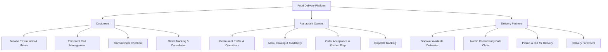

---

## 2. What This System Solves

Modern on-demand food delivery platforms require strict data consistency, financial integrity, and race-condition resistance:

1. **Price Integrity**: Menus change frequently. A customer cannot checkout with outdated cart prices. The system re-reads authoritative MySQL prices at the instant of checkout.
2. **Single-Restaurant Isolation**: Cart items from different restaurants cannot be mixed. The cart enforces single-restaurant integrity and blocks silent cart clearing.
3. **Historical Record Preservation**: Modifying or deleting menu items after an order is placed must never corrupt historical financial receipts or customer order records.
4. **Race-Condition-Free Dispatch**: When multiple delivery partners attempt to claim the same order simultaneously, database-level conditional updates guarantee that exactly one driver succeeds while all others receive `409 Conflict`.
5. **High-Throughput Read Caching**: Menu and restaurant browsing reads are cached in Redis with normalized, parameter-aware cache keys and automated cache eviction upon mutations.

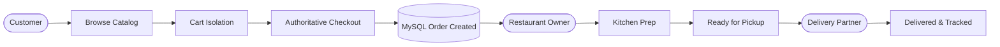

---

## 3. Complete System Flow

The complete end-to-end lifecycle from customer registration to final delivery fulfillment:

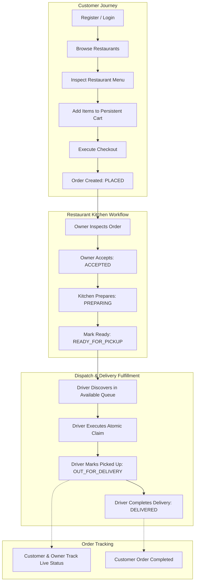

---

## 4. User Roles & Capabilities

| Capability | Customer (`ROLE_CUSTOMER`) | Restaurant Owner (`ROLE_RESTAURANT_OWNER`) | Delivery Partner (`ROLE_DELIVERY_PARTNER`) | Public / Anonymous |
|---|:---:|:---:|:---:|:---:|
| User Registration & Login | Yes | Yes (Created by Admin/Seeding) | Yes (Created by Admin/Seeding) | Yes |
| Browse Restaurants & Menus | Yes | Yes | Yes | Yes |
| Manage Shopping Cart | Yes | No (`403 Forbidden`) | No (`403 Forbidden`) | No (`401 Unauthorized`) |
| Execute Order Checkout | Yes | No (`403 Forbidden`) | No (`403 Forbidden`) | No (`401 Unauthorized`) |
| View Customer Orders | Yes (Own orders only) | No (`403 Forbidden`) | No (`403 Forbidden`) | No (`401 Unauthorized`) |
| Cancel Order (`PLACED`) | Yes | No (`403 Forbidden`) | No (`403 Forbidden`) | No (`401 Unauthorized`) |
| Manage Restaurant Profile | No (`403 Forbidden`) | Yes (Own restaurant only) | No (`403 Forbidden`) | No (`401 Unauthorized`) |
| Manage Menu Items | No (`403 Forbidden`) | Yes (Own restaurant only) | No (`403 Forbidden`) | No (`401 Unauthorized`) |
| Progress Kitchen Status | No (`403 Forbidden`) | Yes (Own restaurant only) | No (`403 Forbidden`) | No (`401 Unauthorized`) |
| Discover Available Deliveries | No (`403 Forbidden`) | No (`403 Forbidden`) | Yes | No (`401 Unauthorized`) |
| Claim Delivery Order | No (`403 Forbidden`) | No (`403 Forbidden`) | Yes (Atomic conditional claim) | No (`401 Unauthorized`) |
| Pickup & Complete Delivery | No (`403 Forbidden`) | No (`403 Forbidden`) | Yes (Assigned orders only) | No (`401 Unauthorized`) |
| Track Delivery Status | Yes (Own orders only) | Yes (Own restaurant only) | Yes (Assigned orders only) | No (`401 Unauthorized`) |

---

## 5. Customer Flow

The customer flow guarantees server-side pricing integrity, single-restaurant cart constraints, and isolated order management.

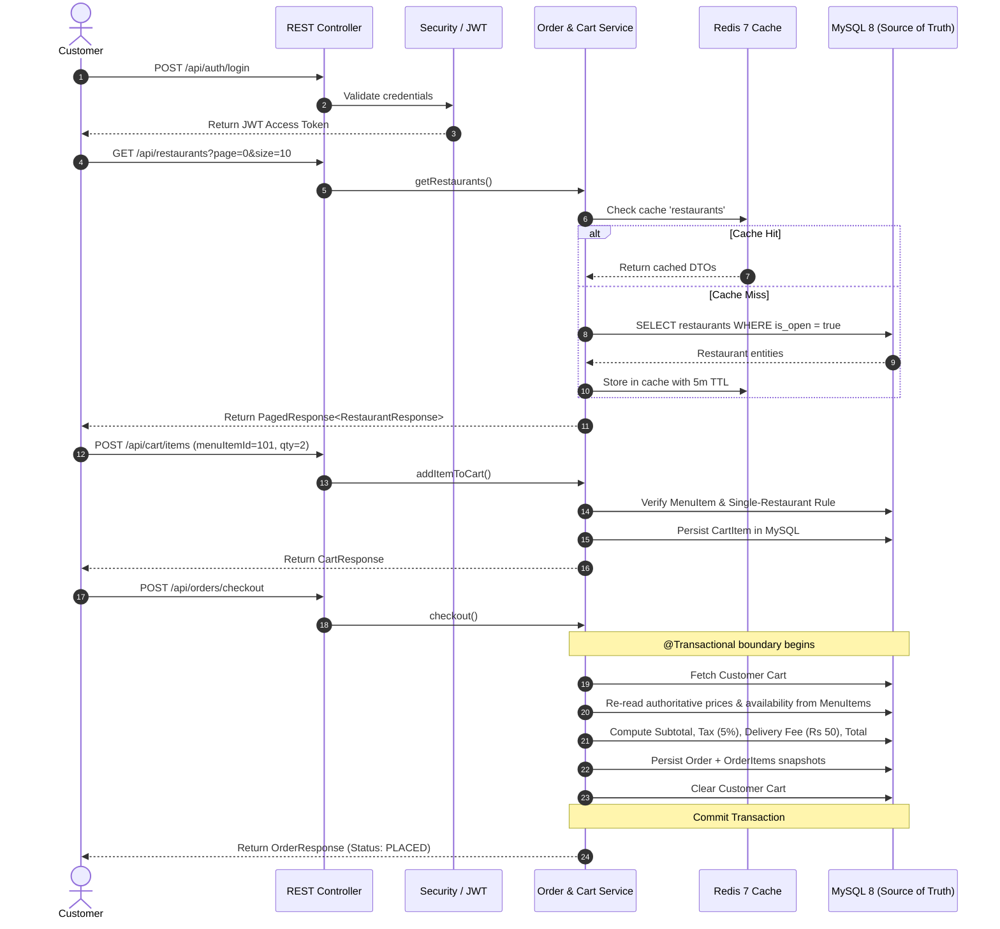

---

## 6. Restaurant Owner Flow

Restaurant owners manage catalog operations and advance order states through the kitchen pipeline with strict resource ownership.

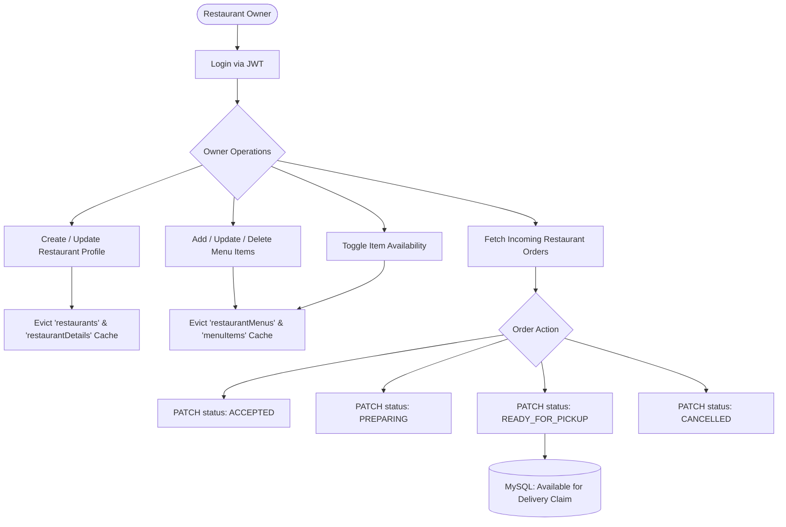

---

## 7. Delivery Partner Flow & Concurrency

When an order reaches `READY_FOR_PICKUP`, it appears in the unassigned delivery queue. Delivery partners can claim orders atomically.

### Concurrency Race Condition Resolution

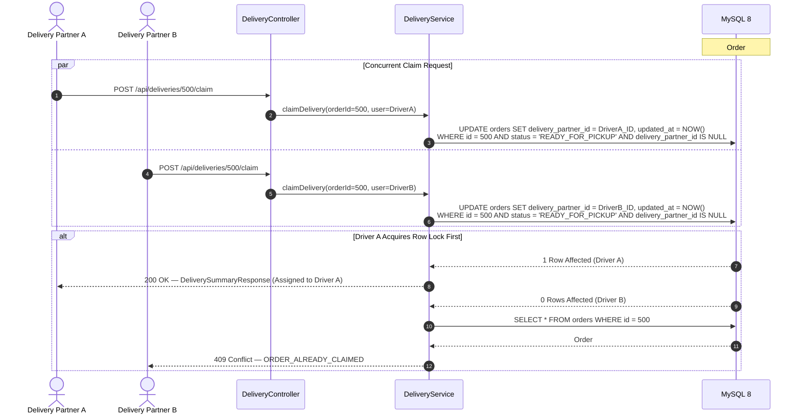

### Delivery Lifecycle State Progression

```mermaid
flowchart LR
    Ready[READY_FOR_PICKUP] -->|POST /api/deliveries/{id}/claim| Claimed[Assigned to Driver]
    Claimed -->|PATCH /api/deliveries/{id}/pickup| Out[OUT_FOR_DELIVERY]
    Out -->|PATCH /api/deliveries/{id}/deliver| Done[DELIVERED]
```

---

## 8. Order Lifecycle & State Machine

The order lifecycle is governed by a centralized transition validator ([OrderStatusTransitionValidator.java](src/main/java/com/example/fooddelivery/enums/OrderStatusTransitionValidator.java)). Arbitrary client status mutations are strictly rejected.

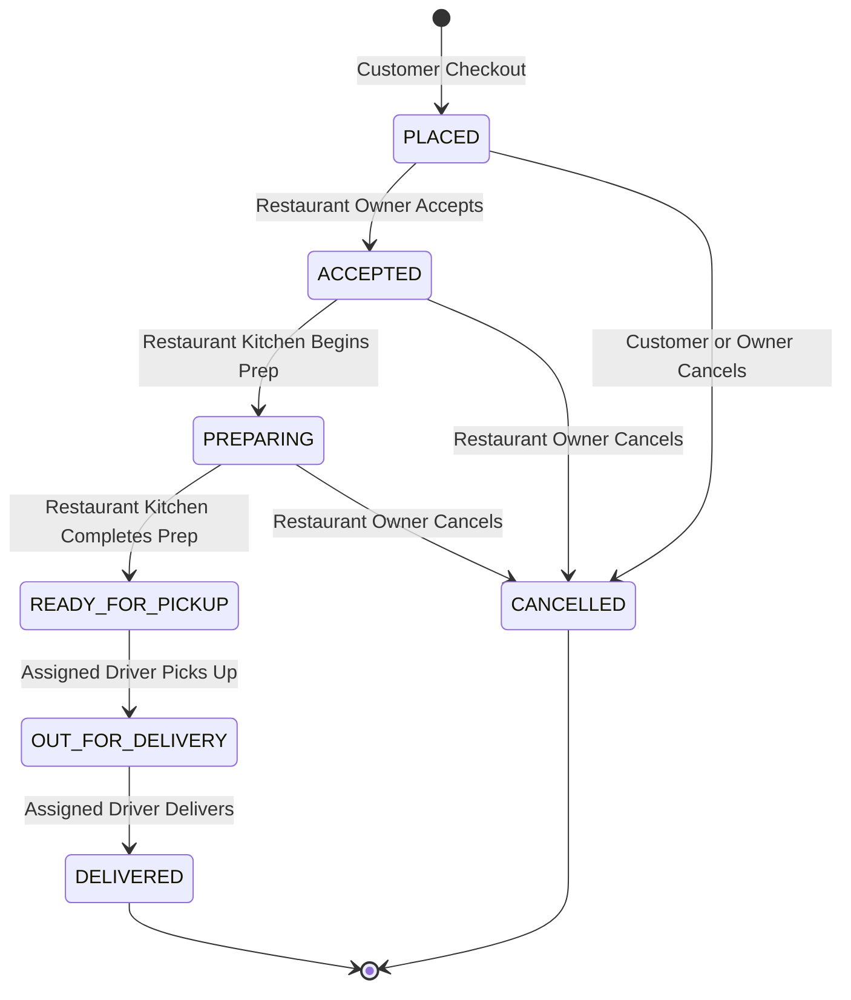

### State Machine Transition Rules Matrix

| Current Status | Target Status | Allowed Actor | Validation Rule |
|---|---|---|---|
| `PLACED` | `ACCEPTED` | Restaurant Owner | Owner must own the restaurant. |
| `PLACED` | `CANCELLED` | Customer / Owner | Customer can cancel only in `PLACED`. |
| `ACCEPTED` | `PREPARING` | Restaurant Owner | Owner advances kitchen workflow. |
| `ACCEPTED` | `CANCELLED` | Restaurant Owner | Owner cancellation before food prep. |
| `PREPARING` | `READY_FOR_PICKUP` | Restaurant Owner | Food is packaged and ready for dispatch. |
| `PREPARING` | `CANCELLED` | Restaurant Owner | Kitchen emergency cancellation. |
| `READY_FOR_PICKUP` | `OUT_FOR_DELIVERY` | Assigned Delivery Partner | Only the assigned driver can pickup. |
| `OUT_FOR_DELIVERY` | `DELIVERED` | Assigned Delivery Partner | Only the assigned driver can mark delivered. |
| `DELIVERED` | *Any* | *None* | Terminal state. No transitions allowed. |
| `CANCELLED` | *Any* | *None* | Terminal state. No transitions allowed. |

---

## 9. Cart & Checkout Invariants

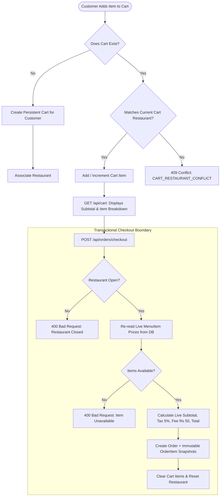

### Key Domain Invariants:
1. **Server-Side Pricing**: The client cannot submit subtotal, tax, fees, or total. All calculations occur server-side.
2. **Authoritative Price Snapshot**: Cart item prices are snapshot guides; checkout **re-reads live database prices** from `menu_items` table.
3. **Single-Restaurant Constraint**: A cart cannot contain items from multiple restaurants simultaneously.
4. **No Silent Cart Clears**: Adding an item from another restaurant returns `409 Conflict` rather than silently clearing the cart.

---

## 10. Authentication & Security Model

The system implements a stateless **Spring Security 6** architecture using **JWT (HMAC-SHA256)** and **BCrypt** password encryption.

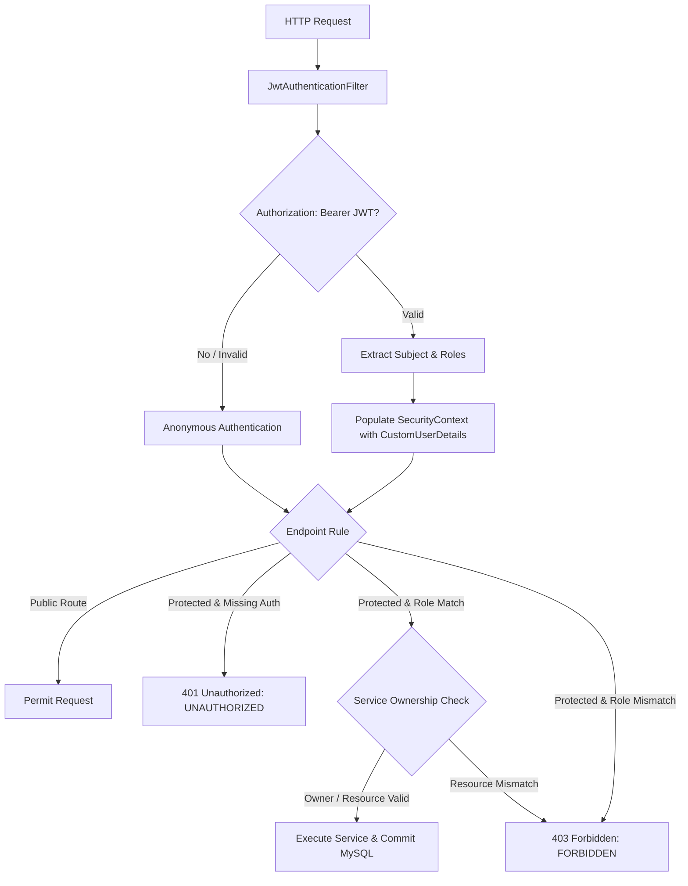

---

## 11. System Architecture

```mermaid
flowchart TB
    subgraph Client Layer
        Web[Web Browser / React / Next.js]
        Mobile[Mobile Application / iOS / Android]
        Postman[Postman / Integration Test Scripts]
    end

    subgraph Security & Ingress Layer
        Security[Spring Security 6 Filter Chain]
        JWT[JwtAuthenticationFilter + BCrypt]
    end

    subgraph Application Layer - Modular Monolith
        AuthController[AuthController]
        RestaurantController[RestaurantController]
        MenuItemController[MenuItemController]
        CartController[CartController]
        OrderController[OrderController & OwnerOrderController]
        DeliveryController[DeliveryController]

        AuthService[AuthService]
        RestaurantService[RestaurantService]
        MenuItemService[MenuItemService]
        CartService[CartService]
        OrderService[OrderService]
        DeliveryService[DeliveryService]
    end

    subgraph Caching Layer
        RedisCacheManager[Spring Cache / RedisCacheManager]
        Redis[('Redis 7 (Alpine)<br/>Catalog Caching Layer')]
    end

    subgraph Persistence Layer
        JPA[Spring Data JPA / Hibernate 6]
        Hikari[HikariCP Connection Pool]
        MySQL[('MySQL 8.0 (InnoDB)<br/>Authoritative Source of Truth')]
    end

    Web --> Security
    Mobile --> Security
    Postman --> Security

    Security --> JWT
    JWT --> AuthController
    JWT --> RestaurantController
    JWT --> MenuItemController
    JWT --> CartController
    JWT --> OrderController
    JWT --> DeliveryController

    AuthController --> AuthService
    RestaurantController --> RestaurantService
    MenuItemController --> MenuItemService
    CartController --> CartService
    OrderController --> OrderService
    DeliveryController --> DeliveryService

    RestaurantService -. Cached Reads .-> RedisCacheManager
    MenuItemService -. Cached Reads .-> RedisCacheManager
    RedisCacheManager <--> Redis

    AuthService --> JPA
    RestaurantService --> JPA
    MenuItemService --> JPA
    CartService --> JPA
    OrderService --> JPA
    DeliveryService --> JPA

    JPA --> Hikari --> MySQL
```

---

## 12. Modular Monolith Design

The application is structured as a **Modular Monolith**. Each domain package encapsulates its own Controllers, Services, DTOs, Mappers, and Repositories while sharing the transactional MySQL database.

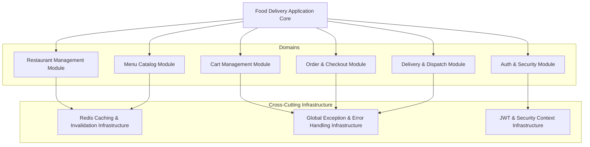

---

## 13. Database Architecture & ER Diagram

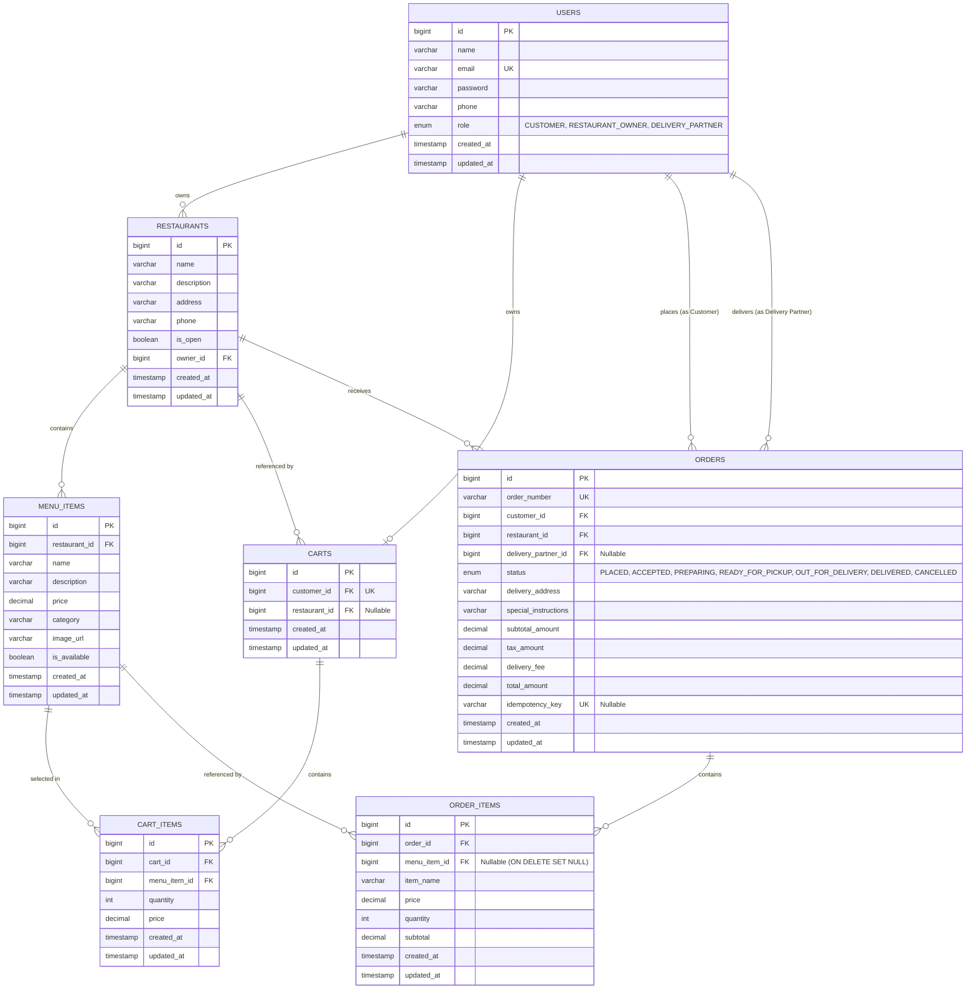

---

## 14. OrderItem Historical Snapshot Pattern

When an order is created, the system decouples future menu changes from past order records.

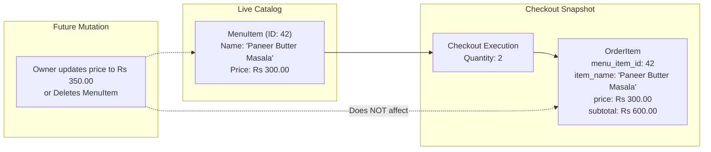

---

## 15. Redis Caching Architecture

Redis 7 is utilized strictly as a high-performance **read-heavy catalog cache**. Transactional data (users, carts, orders, delivery claims) resides exclusively in MySQL.

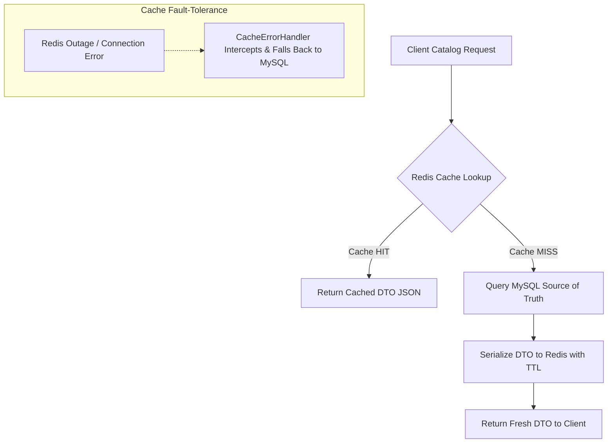

### Cache Configuration & Key Normalization

| Cache Name | Entity / Response Cached | TTL | Normalized Key Structure | Example Key |
|---|---|---|---|---|
| `restaurants` | `PagedResponse<RestaurantResponse>` | 5 min | `list:s={search}:o={isOpen}:p={page}:sz={size}:sort={sort}` | `list:s=pizza:o=true:p=0:sz=10:sort=id: ASC` |
| `restaurantDetails` | `RestaurantResponse` | 10 min | `#id` | `1` |
| `restaurantMenus` | `PagedResponse<MenuItemResponse>` | 5 min | `menu:r={restId}:c={cat}:a={avail}:s={search}:p={p}:sz={sz}:sort={sort}` | `menu:r=1:c=main:a=true:s=:p=0:sz=20:sort=id: ASC` |
| `menuItems` | `MenuItemResponse` | 10 min | `#id` | `101` |

---

## 16. Cache Invalidation Matrix

To prevent stale data, all catalog mutations automatically evict affected cache entries via `@CacheEvict`.

```mermaid
flowchart LR
    Mutation[Catalog Mutation: Create / Update / Delete / Toggle Status] --> MySQL[(MySQL Write Committed)]
    MySQL --> Evict[@CacheEvict Triggered]
    Evict --> EvictDetails[Evict Specific Key #id]
    Evict --> EvictLists[Evict All List Cache Entries]
```

| Operation | Triggering Endpoint | Evicted Cache Names | Invalidation Mode |
|---|---|---|---|
| Create Restaurant | `POST /api/restaurants` | `restaurants` | All entries (`allEntries = true`) |
| Update Restaurant | `PUT /api/restaurants/{id}` | `restaurants`, `restaurantDetails` | `#id` and all list entries |
| Toggle Restaurant Status | `PATCH /api/restaurants/{id}/status` | `restaurants`, `restaurantDetails`, `restaurantMenus` | `#id` and all list entries |
| Delete Restaurant | `DELETE /api/restaurants/{id}` | `restaurants`, `restaurantDetails`, `restaurantMenus` | `#id` and all list entries |
| Create Menu Item | `POST /api/restaurants/{id}/menu` | `restaurantMenus` | All entries (`allEntries = true`) |
| Update Menu Item | `PUT /api/menu-items/{id}` | `menuItems`, `restaurantMenus` | `#id` and all list entries |
| Toggle Item Availability | `PATCH /api/menu-items/{id}/status` | `menuItems`, `restaurantMenus` | `#id` and all list entries |
| Delete Menu Item | `DELETE /api/menu-items/{id}` | `menuItems`, `restaurantMenus` | `#id` and all list entries |

---

## 17. API Reference

### Authentication API (`/api/auth`)

| Method | Endpoint | Access | Description |
|---|---|---|---|
| `POST` | `/api/auth/register` | Public | Register a new customer account |
| `POST` | `/api/auth/login` | Public | Authenticate and receive JWT access token |

### Restaurant Management API (`/api/restaurants`)

| Method | Endpoint | Access | Description |
|---|---|---|---|
| `GET` | `/api/restaurants` | Public | List open/filtered restaurants (paginated, cached) |
| `GET` | `/api/restaurants/{id}` | Public | Get restaurant details by ID (cached) |
| `POST` | `/api/restaurants` | `RESTAURANT_OWNER` | Register a new restaurant |
| `PUT` | `/api/restaurants/{id}` | `RESTAURANT_OWNER` | Update restaurant details (ownership verified) |
| `PATCH` | `/api/restaurants/{id}/status` | `RESTAURANT_OWNER` | Toggle restaurant open/closed status |
| `DELETE` | `/api/restaurants/{id}` | `RESTAURANT_OWNER` | Delete restaurant |

### Menu Management API (`/api/restaurants/{id}/menu` & `/api/menu-items`)

| Method | Endpoint | Access | Description |
|---|---|---|---|
| `GET` | `/api/restaurants/{id}/menu` | Public | Get restaurant menu items (paginated, filtered, cached) |
| `GET` | `/api/menu-items/{id}` | Public | Get menu item detail by ID (cached) |
| `POST` | `/api/restaurants/{id}/menu` | `RESTAURANT_OWNER` | Add a new menu item to restaurant |
| `PUT` | `/api/menu-items/{id}` | `RESTAURANT_OWNER` | Update menu item details |
| `PATCH` | `/api/menu-items/{id}/status` | `RESTAURANT_OWNER` | Toggle menu item availability |
| `DELETE` | `/api/menu-items/{id}` | `RESTAURANT_OWNER` | Delete menu item |

### Cart Management API (`/api/cart`)

| Method | Endpoint | Access | Description |
|---|---|---|---|
| `GET` | `/api/cart` | `CUSTOMER` | Retrieve authenticated customer's cart |
| `POST` | `/api/cart/items` | `CUSTOMER` | Add item or increment quantity |
| `PUT` | `/api/cart/items/{itemId}` | `CUSTOMER` | Update cart item quantity (0 removes item) |
| `DELETE` | `/api/cart/items/{itemId}` | `CUSTOMER` | Remove single item from cart |
| `DELETE` | `/api/cart` | `CUSTOMER` | Clear all items and reset restaurant association |

### Order & Checkout API (`/api/orders`)

| Method | Endpoint | Access | Description |
|---|---|---|---|
| `POST` | `/api/orders/checkout` | `CUSTOMER` | Execute transactional checkout from cart |
| `GET` | `/api/orders/my` | `CUSTOMER` | List authenticated customer's order history |
| `GET` | `/api/orders/{id}` | `CUSTOMER` | Get customer order details by ID |
| `PATCH` | `/api/orders/{id}/cancel` | `CUSTOMER` | Cancel order (only if `PLACED`) |
| `GET` | `/api/orders/{id}/delivery` | `CUSTOMER` | Track delivery status for customer order |

### Owner Order Management API (`/api/owner/orders`)

| Method | Endpoint | Access | Description |
|---|---|---|---|
| `GET` | `/api/owner/orders` | `RESTAURANT_OWNER` | List orders for owner's restaurant (filter by status) |
| `PATCH` | `/api/owner/orders/{id}/status` | `RESTAURANT_OWNER` | Update status (`ACCEPTED`, `PREPARING`, `READY_FOR_PICKUP`, `CANCELLED`) |
| `GET` | `/api/owner/orders/{id}/delivery` | `RESTAURANT_OWNER` | Track delivery status for owner's restaurant order |

### Delivery & Dispatch API (`/api/deliveries` & `/api/delivery/orders`)

| Method | Endpoint | Access | Description |
|---|---|---|---|
| `GET` | `/api/deliveries/available` | `DELIVERY_PARTNER` | List unassigned orders in `READY_FOR_PICKUP` status |
| `POST` | `/api/deliveries/{id}/claim` | `DELIVERY_PARTNER` | Atomically claim order for authenticated driver |
| `GET` | `/api/deliveries/my` | `DELIVERY_PARTNER` | List orders assigned to authenticated driver |
| `PATCH` | `/api/deliveries/{id}/pickup` | `DELIVERY_PARTNER` | Transition order to `OUT_FOR_DELIVERY` |
| `PATCH` | `/api/deliveries/{id}/deliver` | `DELIVERY_PARTNER` | Transition order to `DELIVERED` |
| `GET` | `/api/delivery/orders/available` | `DELIVERY_PARTNER` | Phase 6 backward-compatible available orders |
| `POST` | `/api/delivery/orders/{id}/claim` | `DELIVERY_PARTNER` | Phase 6 backward-compatible order claim |
| `GET` | `/api/delivery/orders/my` | `DELIVERY_PARTNER` | Phase 6 backward-compatible my deliveries |
| `PATCH` | `/api/delivery/orders/{id}/status` | `DELIVERY_PARTNER` | Phase 6 backward-compatible status transition |

### System & Health API (`/api/health` & `/actuator`)

| Method | Endpoint | Access | Description |
|---|---|---|---|
| `GET` | `/api/health` | Public | System health status & timestamp |
| `GET` | `/actuator/health` | Public | Spring Boot Actuator liveness/readiness probe |
| `GET` | `/actuator/info` | Public | Application build information |

---

## 18. Complete API Flow

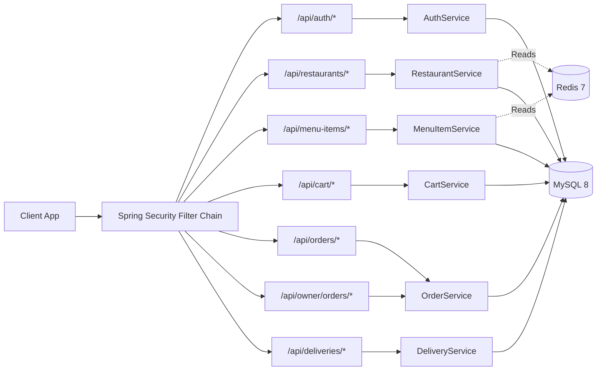

---

## 19. Error Handling & Exception Architecture

All exceptions are intercepted by [GlobalExceptionHandler.java](src/main/java/com/example/fooddelivery/exception/GlobalExceptionHandler.java) and converted into structured `ErrorResponse` DTOs.

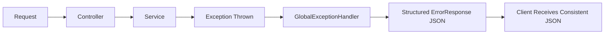

### Standard Error Response Schema

```json
{
  "status": 409,
  "error": "CART_RESTAURANT_CONFLICT",
  "message": "Cart contains items from another restaurant. Clear cart to add items from this restaurant.",
  "path": "/api/cart/items",
  "timestamp": "2026-09-14T10:55:00Z",
  "errors": null
}
```

### Handled HTTP Status Codes:
- `400 Bad Request`: `MethodArgumentNotValidException` (DTO validation failures), `IllegalArgumentException`, `IllegalOrderStateTransitionException`.
- `401 Unauthorized`: `BadCredentialsException`, `UsernameNotFoundException`, `AuthenticationException`.
- `403 Forbidden`: `AccessDeniedException` (Role or Resource Ownership violations).
- `404 Not Found`: `ResourceNotFoundException`.
- `409 Conflict`: `UserAlreadyExistsException`, `CartConflictException`, `OrderConflictException` (delivery race conditions), `DataIntegrityViolationException`.
- `500 Internal Server Error`: Generic unhandled exceptions.

---

## 20. Pagination, Sorting & Filtering

Endpoints returning collections support Spring Data `Pageable` parameters with safe defaults:
- `page`: 0-indexed page number (default: `0`).
- `size`: Page size (default: `20`, maximum constrained).
- `sort`: Dynamic sort field and direction (e.g., `sort=name,asc` or `sort=createdAt,desc`).

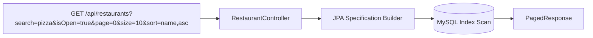

---

## 21. Validation Model

Validation is enforced across three distinct layers to prevent corrupted state:

```text
HTTP Request Body
       ↓
Layer 1: Bean Validation (Jakarta @NotNull, @NotBlank, @Min, @Email, @Size)
       ↓
Layer 2: Service-Level Business Logic (Ownership checks, State Transitions, Restaurant Open status)
       ↓
Layer 3: Database Constraints (Foreign Keys, Unique Indexes, NOT NULL columns)
```

---

## 22. Project Structure

```text
src/
├── main/
│   ├── java/com/example/fooddelivery/
│   │   ├── config/              # Redis, Security, CacheKeyUtils, App Config
│   │   ├── controller/          # REST API Controllers
│   │   ├── dto/
│   │   │   ├── request/         # Request Records (Validation Annotations)
│   │   │   └── response/        # Response Records (DTO / Entity Separation)
│   │   ├── entity/              # JPA Entities (User, Restaurant, MenuItem, Cart, Order)
│   │   ├── enums/               # OrderStatus, Role, OrderStatusTransitionValidator
│   │   ├── exception/           # Custom Domain Exceptions & GlobalExceptionHandler
│   │   ├── mapper/              # Object Mappers (Entity -> Response DTOs)
│   │   ├── repository/          # Spring Data JPA Repositories (Custom JPQL & Native Queries)
│   │   ├── security/            # JWT Token Provider, Auth Filter, CustomUserDetails
│   │   └── service/             # Business Logic Interfaces & Service Implementations
│   └── resources/
│       ├── application.yml      # Base configuration
│       ├── application-dev.yml  # Development profile
│       └── application-test.yml # Test profile (H2 in-memory DB)
└── test/
    └── java/com/example/fooddelivery/
        ├── config/              # Redis & Cache Key tests
        ├── controller/          # MockMvc Integration Tests
        ├── repository/          # JPA Specification & Repository tests
        ├── security/            # JWT & Security tests
        └── service/             # Service Unit & Concurrency Tests
```

---

## 23. Technology Stack

| Component | Technology | Version | Purpose |
|---|---|---|---|
| Language | Java | 21 (LTS) | Core programming language (Records, Pattern Matching) |
| Framework | Spring Boot | 3.4.3 | Application core, Web MVC, Dependency Injection |
| Security | Spring Security | 6.x | Stateless JWT authentication, role authorization |
| Database | MySQL | 8.0 | Authoritative transactional relational database |
| In-Memory Cache | Redis | 7.0 Alpine | Read-heavy catalog cache (Jackson JSON serialized) |
| ORM | Hibernate / JPA | 6.x | Relational persistence mapping |
| Connection Pool | HikariCP | Default | Production high-performance JDBC connection pool |
| Build Tool | Maven | 3.9+ | Build lifecycle & dependency management |
| Testing | JUnit 5 & Mockito | 5.x / 5.x | Unit and mock testing |
| Integration Testing | Spring MockMvc & H2 | Latest | Controller HTTP testing & transactional testing |
| Containerization | Docker & Compose | Latest | Orchestration for MySQL 8 and Redis 7 |

---

## 24. Non-Functional Engineering Design

- **Security**: Stateless JWT with HMAC-SHA256, BCrypt password hashing (strength 10), method-level `@PreAuthorize`, and service-layer resource ownership checks.
- **Transactional Consistency**: `@Transactional` boundaries enforce atomic cart checkout and price snapshot creation. MySQL is the single authoritative source of truth.
- **Concurrency Safety**: Atomic conditional SQL updates protect delivery order claims without distributed locking overhead.
- **Catalog Performance**: Redis caching reduces repeat database load for high-traffic restaurant and menu browsing.
- **Zero Cache Drift**: Synchronous cache evictions ensure catalog updates are immediately reflected in read APIs.
- **Resilience**: Redis outages gracefully degrade to direct database queries without causing 500 errors.

---

## 25. Testing & Quality Assurance

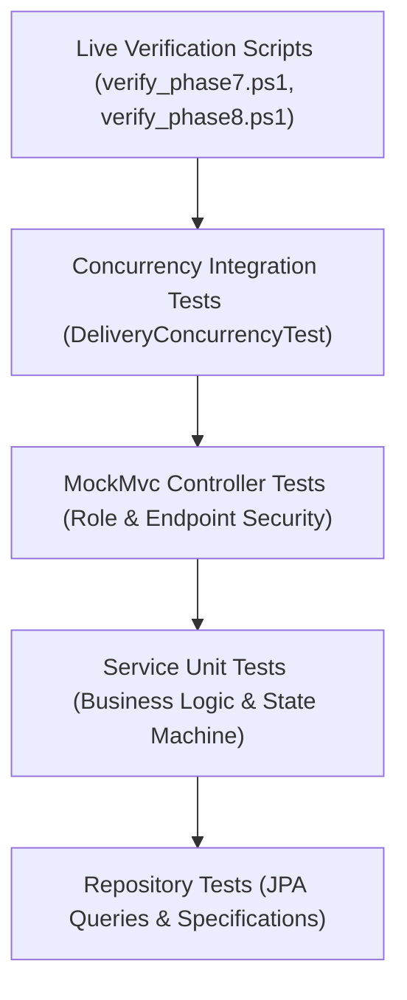

### Test Suite Execution Summary

```powershell
.\mvnw.cmd test
```

```text
[INFO] Results:
[INFO] 
[INFO] Tests run: 156, Failures: 0, Errors: 0, Skipped: 0
[INFO] 
[INFO] ------------------------------------------------------------------------
[INFO] BUILD SUCCESS
[INFO] ------------------------------------------------------------------------
```

---

## 26. Live Verification

Automated PowerShell verification scripts validate the backend against live Docker instances of MySQL 8 and Redis 7:

- [verify_phase7.ps1](verify_phase7.ps1): Validates Redis connectivity, cache hits, key segregation, price mutation invalidation, availability toggle invalidation, and checkout price snapshot integrity.
- [verify_phase8.ps1](verify_phase8.ps1): Validates driver discovery, atomic claims, concurrent claim rejection (409 Conflict), kitchen-to-dispatch lifecycle progression, customer/owner delivery tracking isolation, and Phase 6 legacy backward compatibility.

---

## 27. Getting Started & Setup

### Prerequisites
- **Java 21 JDK** installed and configured (`JAVA_HOME`).
- **Docker Desktop** installed and running.
- **Git** and **Maven** (or use included `./mvnw`).

### 1. Clone the Repository
```bash
git clone https://github.com/your-username/food-delivery-backend.git
cd food-delivery-backend
```

### 2. Start MySQL & Redis Containers
```bash
docker compose up -d
```

### 3. Configure Environment Variables
Copy `.env.example` to `.env` or set environment variables:
```properties
DB_HOST=localhost
DB_PORT=3306
DB_NAME=food_delivery_db
DB_USERNAME=food_user
DB_PASSWORD=food_password
REDIS_HOST=localhost
REDIS_PORT=6379
REDIS_PASSWORD=
JWT_SECRET=your_base64_encoded_256_bit_secure_jwt_secret_key_here
JWT_EXPIRATION_MS=86400000
SERVER_PORT=8080
```

### 4. Build and Run the Application
**Linux / macOS:**
```bash
./mvnw spring-boot:run
```
**Windows:**
```powershell
.\mvnw.cmd spring-boot:run
```

### 5. Run the Full Test Suite
```powershell
.\mvnw.cmd test
```

---

## 28. Business Rules & Domain Invariants

```text
Authentication & Authorization
├── Public registration assigns ROLE_CUSTOMER exclusively.
├── Role identity cannot be client-supplied in registration payloads.
└── JWT token must be supplied in 'Authorization: Bearer <token>' header.

Restaurant & Menu Management
├── Only authenticated RESTAURANT_OWNER users can create restaurants.
├── Owners can only modify restaurants and menu items that they own.
└── Closed restaurants cannot accept new checkout orders.

Cart & Pricing
├── Each customer has exactly one persistent cart.
├── Carts enforce single-restaurant integrity (mixing restaurants returns 409 Conflict).
├── Cart prices are informational snapshots; checkout re-reads live MenuItem prices.
└── Successful checkout clears the cart and resets restaurant association.

Order Lifecycle & State Transitions
├── PLACED -> ACCEPTED -> PREPARING -> READY_FOR_PICKUP -> OUT_FOR_DELIVERY -> DELIVERED.
├── Customers can only cancel orders in 'PLACED' status.
├── Owners can cancel orders in 'PLACED', 'ACCEPTED', or 'PREPARING' status.
└── DELIVERED and CANCELLED are immutable terminal states.

Delivery & Dispatch
├── Only DELIVERY_PARTNER users can claim and fulfill deliveries.
├── Order claims are atomic (conditional SQL prevents race conditions).
└── Delivery partners can only pickup and deliver orders assigned to them.
```

---

## 29. Architectural Decision Records (ADR)

### ADR 1: Modular Monolith vs. Microservices
- **Decision**: Build as a Modular Monolith.
- **Rationale**: Eliminates distributed transaction complexities (2PC / Sagas) for cart checkout and order placement while maintaining clean domain boundaries, unified transactions, and fast local communication.

### ADR 2: MySQL as Authoritative Source of Truth
- **Decision**: MySQL 8 (InnoDB) is the sole transactional source of truth.
- **Rationale**: Ensures ACID guarantees for financial calculations, order snapshots, and atomic delivery claims.

### ADR 3: Redis Exclusively as a Read Cache
- **Decision**: Redis is strictly a catalog cache, not a transactional database.
- **Rationale**: Prevents data loss or inconsistency during cache eviction or Redis restarts. Financial data and carts remain safely in MySQL.

### ADR 4: Database Conditional Update for Delivery Claims
- **Decision**: Use `UPDATE orders SET delivery_partner_id = :id WHERE id = :orderId AND status = 'READY_FOR_PICKUP' AND delivery_partner_id IS NULL`.
- **Rationale**: Guarantees race-condition safety at the database engine level with zero distributed lock overhead.

---

## 30. Possible Future Enhancements

The following items represent potential future expansion points:
- **Payment Gateway Integration**: Webhook-driven payment processing (Stripe / Razorpay) with two-phase capture.
- **Real-Time WebSockets**: Live order tracking updates for customer and restaurant web dashboards.
- **Push Notifications**: Automated SMS / Email notifications via Firebase or AWS SNS upon order state changes.
- **Driver Geolocation**: Geospatial querying for nearest available delivery partners using PostGIS / Redis GEO.
- **Analytics & Reporting**: Daily/monthly restaurant sales summaries and driver payout metrics.

---

## License

This project is licensed under the MIT License.
