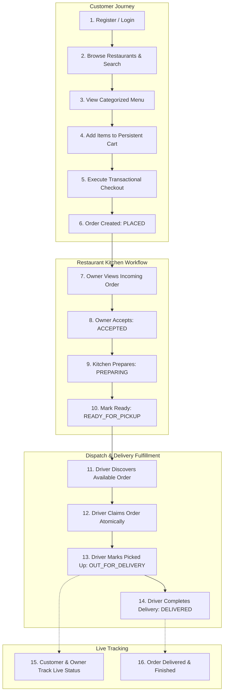
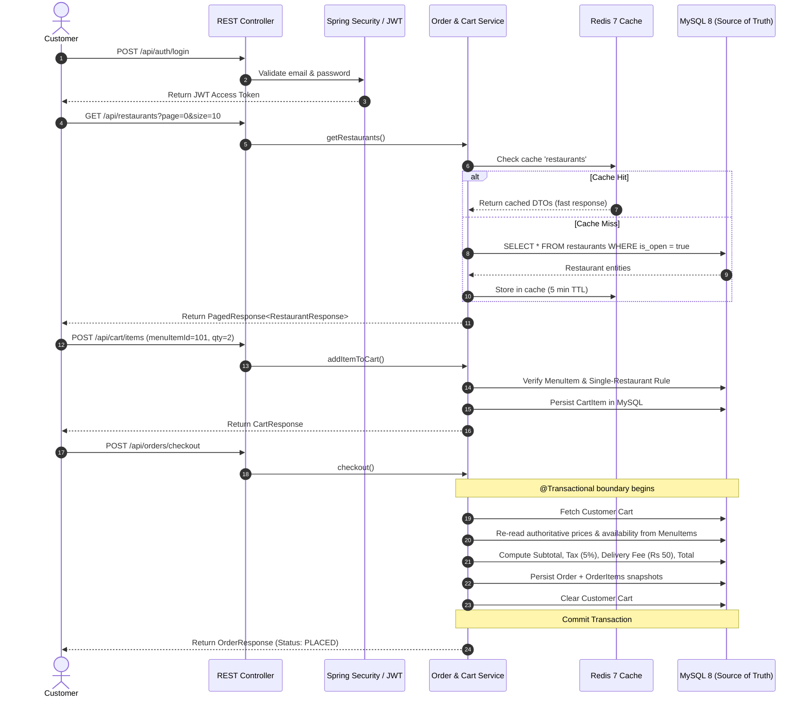
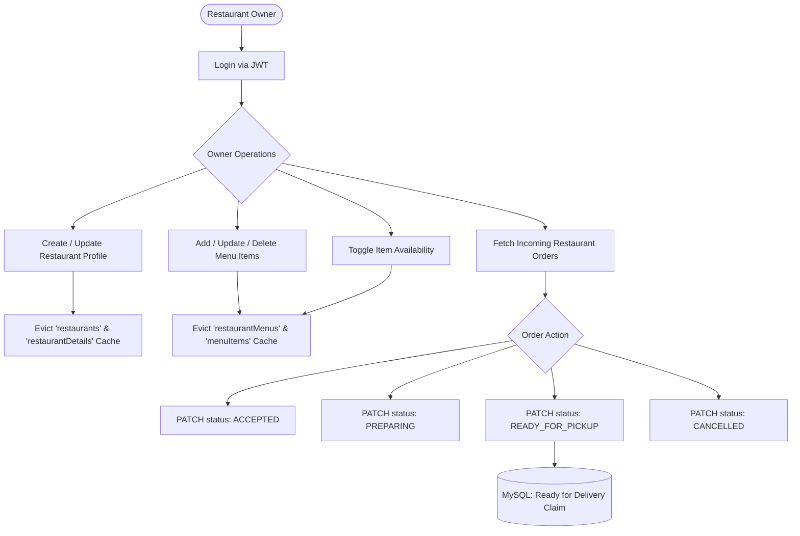
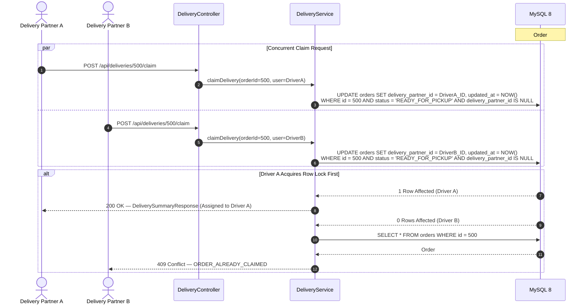
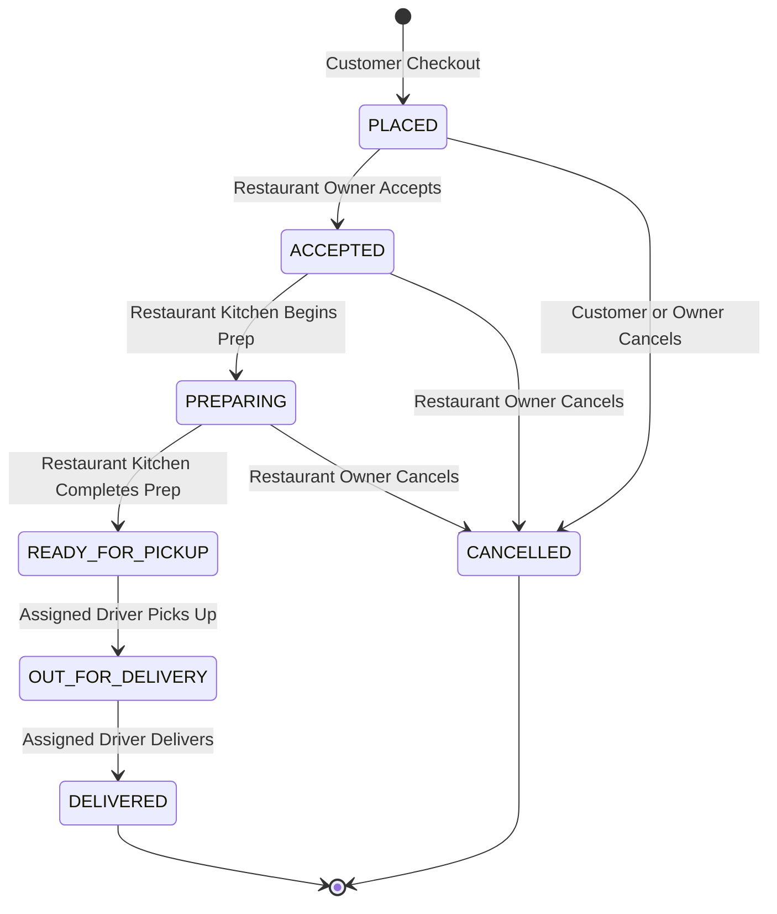
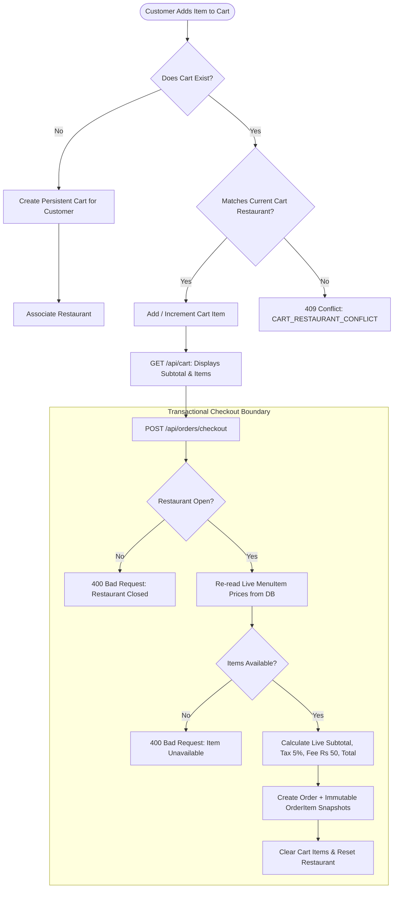
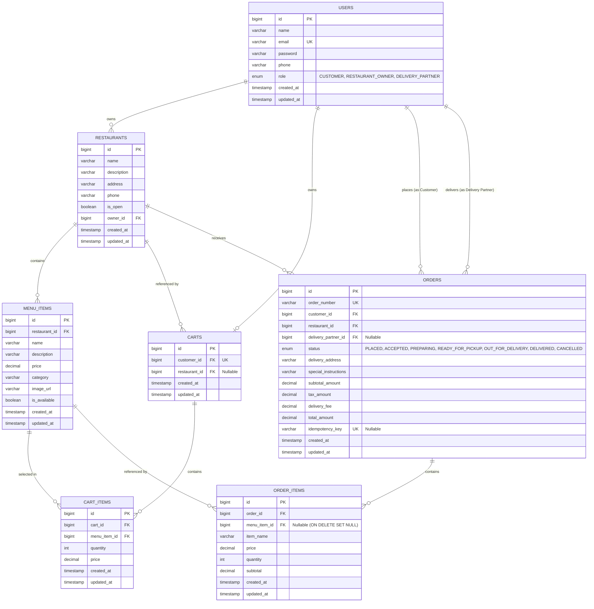
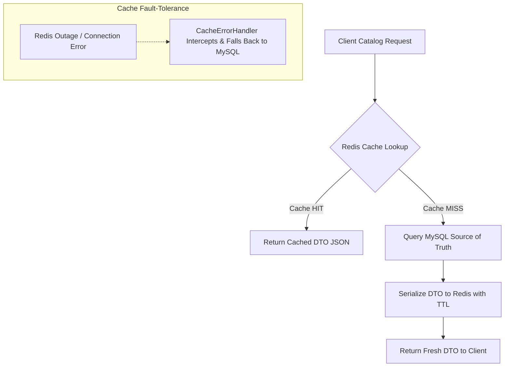

```mermaid
flowchart TB
    Platform[Food Delivery Platform]

    Platform --> Customers[Customer Role]
    Platform --> Owners[Restaurant Owner Role]
    Platform --> Drivers[Delivery Partner Role]

    Customers --> C1[Browse Restaurants & Menus]
    Customers --> C2[Manage Shopping Cart]
    Customers --> C3[Execute Checkout]
    Customers --> C4[Cancel Placed Orders]
    Customers --> C5[Track Delivery Status]

    Owners --> O1[Manage Restaurant Profile]
    Owners --> O2[Manage Menu Items & Prices]
    Owners --> O3[Toggle Item Availability]
    Owners --> O4[Manage Incoming Orders]
    Owners --> O5[Progress Kitchen Status]

    Drivers --> D1[Discover Available Deliveries]
    Drivers --> D2[Atomic Concurrency-Safe Claim]
    Drivers --> D3[Pickup: OUT_FOR_DELIVERY]
    Drivers --> D4[Complete: DELIVERED]
    Drivers --> D5[View Assigned Delivery History]
```

# Food Delivery Backend — System Flow Diagrams & Architecture

This document contains comprehensive visual diagrams and ASCII flowcharts for all user personas, domain lifecycles, concurrency guarantees, and system architecture.

---

## Table of Contents

- [1. Complete System Flow (All Users Combined)](#1-complete-system-flow-all-users-combined)
- [2. User Roles & Capabilities](#2-user-roles--capabilities)
- [3. Customer Journey Flow](#3-customer-journey-flow)
- [4. Restaurant Owner Flow](#4-restaurant-owner-flow)
- [5. Delivery Partner Flow & Concurrency Race](#5-delivery-partner-flow--concurrency-race)
- [6. Order Lifecycle State Machine](#6-order-lifecycle-state-machine)
- [7. Cart & Checkout Invariants Flow](#7-cart--checkout-invariants-flow)
- [8. Security & Authorization Model](#8-security--authorization-model)
- [9. Layered System Architecture](#9-layered-system-architecture)
- [10. Database Architecture & ER Diagram](#10-database-architecture--er-diagram)
- [11. Redis Caching & Invalidation Architecture](#11-redis-caching--invalidation-architecture)

---

## 1. Complete System Flow (All Users Combined)

### Visual ASCII Flowchart

```text
========================================================================================================
                                      COMPLETE SYSTEM FLOW
========================================================================================================

 [ CUSTOMER ]                    [ RESTAURANT OWNER ]                 [ DELIVERY PARTNER ]
      │                                    │                                    │
      ▼                                    │                                    │
  1. Register / Login                      │                                    │
      │                                    │                                    │
      ▼                                    │                                    │
  2. Browse Restaurants & Menus            │                                    │
     (Redis Cache Layer)                   │                                    │
      │                                    │                                    │
      ▼                                    │                                    │
  3. Add Items to Cart                     │                                    │
     (Single-Restaurant Rule)              │                                    │
      │                                    │                                    │
      ▼                                    │                                    │
  4. Checkout                              │                                    │
     (Re-reads Live DB Prices)             │                                    │
      │                                    │                                    │
      ▼                                    ▼                                    │
  ┌────────────────────────────────────────────────────────┐                    │
  │ Order Status: [ PLACED ]                               │                    │
  └────────────────────────────────────────────────────────┘                    │
                                           │                                    │
                                           ▼                                    │
                               5. Owner Accepts Order                           │
                               ┌───────────────────────────┐                    │
                               │ Order Status: [ ACCEPTED ]│                    │
                               └───────────────────────────┘                    │
                                           │                                    │
                                           ▼                                    │
                               6. Kitchen Begins Prep                           │
                               ┌────────────────────────────┐                   │
                               │ Order Status: [ PREPARING ]│                   │
                               └────────────────────────────┘                   │
                                           │                                    │
                                           ▼                                    │
                               7. Food Packaged & Ready                         │
                               ┌──────────────────────────────────┐             │
                               │ Order Status: [ READY_FOR_PICKUP ] ──┐         │
                               └──────────────────────────────────┘   │         │
                                                                      │         ▼
                                                          8. Discovers in Available Queue
                                                                      │
                                                                      ▼
                                                          9. Atomic Claim (MySQL Lock)
                                                                      │
                                                                      ▼
                                                         10. Pick Up Order
                                                             ┌──────────────────────────────────┐
                                                             │ Order Status: [ OUT_FOR_DELIVERY]│
                                                             └──────────────────────────────────┘
                                                                      │
                                                                      ▼
                                                         11. Mark Delivered
                                                             ┌─────────────────────────────┐
  12. Customer Receives Food <───────────────────────────────│ Order Status: [ DELIVERED ] │
      & Order Completed                                      └─────────────────────────────┘
========================================================================================================
```

### Mermaid Diagram



---

## 2. User Roles & Capabilities

### Visual ASCII Role Map

```text
┌────────────────────────────────────────────────────────────────────────┐
│                        FOOD DELIVERY PLATFORM                          │
└───────────────────────────────────┬────────────────────────────────────┘
                                    │
          ┌─────────────────────────┼─────────────────────────┐
          │                         │                         │
          ▼                         ▼                         ▼
   [ CUSTOMER ]             [ RESTAURANT OWNER ]      [ DELIVERY PARTNER ]
   • Register / Login       • Manage Restaurant       • Find Available Orders
   • Browse Catalog         • Manage Menu & Prices    • Atomic Claim
   • Manage Cart            • Toggle Availability     • Pick Up Orders
   • Checkout               • Accept / Prepare Order  • Mark Delivered
   • Cancel Placed Order    • Dispatch Order          • View Delivery History
   • Track Delivery         • Track Dispatch          • Track Status
```

### Mermaid Diagram



---

## 3. Customer Journey Flow

### Visual ASCII Sequence

```text
CUSTOMER                    API / CONTROLLER              REDIS CACHE                MYSQL DATABASE
   │                              │                            │                           │
   │── 1. POST /api/auth/login ──>│                            │                           │
   │<─ 2. JWT Access Token ───────│                            │                           │
   │                              │                            │                           │
   │── 3. GET /api/restaurants ──>│                            │                           │
   │                              │── 4. Check Cache ─────────>│                           │
   │                              │<─ 5. Cache Miss ───────────│                           │
   │                              │── 6. Query Open Restaurants ──────────────────────────>│
   │                              │<─ 7. Restaurant Records ───────────────────────────────│
   │                              │── 8. Cache DTOs (5m TTL) ─>│                           │
   │<─ 9. Restaurant List ────────│                            │                           │
   │                              │                            │                           │
   │── 10. POST /api/cart/items ─>│ (menuItemId=101, qty=2)    │                           │
   │                              │── 11. Validate Single Restaurant & Save ──────────────>│
   │<─ 12. CartResponse ──────────│                            │                           │
   │                              │                            │                           │
   │── 13. POST /checkout ───────>│                            │                           │
   │                              │── 14. [TRANSACTION BEGIN] ────────────────────────────>│
   │                              │── 15. Re-read Live MenuItem Prices ───────────────────>│
   │                              │── 16. Compute Subtotal + Tax + Delivery Fee ──────────>│
   │                              │── 17. Insert Order & OrderItem Snapshots ─────────────>│
   │                              │── 18. Clear Customer Cart ────────────────────────────>│
   │                              │── 19. [TRANSACTION COMMIT] ───────────────────────────>│
   │<─ 20. Order (Status: PLACED)─│                            │                           │
```

### Mermaid Diagram



---

## 4. Restaurant Owner Flow

### Visual ASCII Flowchart

```text
[ RESTAURANT OWNER ]
         │
         ├──► 1. Manage Restaurant Profile ──► Evict 'restaurants' & 'restaurantDetails' Cache
         │
         ├──► 2. Manage Menu Items & Prices ─► Evict 'restaurantMenus' & 'menuItems' Cache
         │
         ├──► 3. Toggle Availability ────────► Evict 'restaurantMenus' Cache
         │
         └──► 4. Kitchen Order Management:
                     │
                     ▼
                 [ PLACED ]
                     │
                     ▼ (PATCH /api/owner/orders/{id}/status -> ACCEPTED)
                 [ ACCEPTED ]
                     │
                     ▼ (PATCH /api/owner/orders/{id}/status -> PREPARING)
                 [ PREPARING ]
                     │
                     ▼ (PATCH /api/owner/orders/{id}/status -> READY_FOR_PICKUP)
             [ READY_FOR_PICKUP ] ──► (Appears in Driver Available Deliveries Queue)
```

### Mermaid Diagram



---

## 5. Delivery Partner Flow & Concurrency Race

### Visual ASCII Race Condition Resolution

```text
Order #500: [ READY_FOR_PICKUP ] (delivery_partner_id = NULL)

  DRIVER A (Requests Claim)                       DRIVER B (Requests Claim)
         │                                               │
         ▼                                               ▼
POST /api/deliveries/500/claim                  POST /api/deliveries/500/claim
         │                                               │
         ▼                                               ▼
┌─────────────────────────────────────────────────────────────────────────────┐
│                       ATOMIC MYSQL DATABASE UPDATE                          │
│                                                                             │
│  UPDATE orders                                                              │
│  SET delivery_partner_id = :driverId, updated_at = NOW()                    │
│  WHERE id = 500 AND status = 'READY_FOR_PICKUP'                             │
│    AND delivery_partner_id IS NULL;                                         │
└─────────────────────────────────────────────────────────────────────────────┘
         │                                               │
         ▼                                               ▼
  [ 1 Row Affected ]                              [ 0 Rows Affected ]
         │                                               │
         ▼                                               ▼
  HTTP 200 OK                                     HTTP 409 CONFLICT
  (Driver A Claims Order)                         (ORDER_ALREADY_CLAIMED)
         │
         ▼ (PATCH /api/deliveries/500/pickup)
  [ OUT_FOR_DELIVERY ]
         │
         ▼ (PATCH /api/deliveries/500/deliver)
  [ DELIVERED ]
```

### Mermaid Diagram



---

## 6. Order Lifecycle State Machine

### Visual ASCII State Diagram

```text
                     ┌──────────────────┐
                     │     PLACED       │
                     └────────┬─────────┘
                              │
            ┌─────────────────┴─────────────────┐
            │                                   │
            ▼ (Owner Accepts)                   ▼ (Customer/Owner Cancels)
     ┌──────────────┐                   ┌───────────────┐
     │   ACCEPTED   │                   │   CANCELLED   │◄─── [Terminal State]
     └──────┬───────┘                   └───────────────┘
            │                                   ▲
            │ (Owner Prepares)                  │ (Owner Cancels)
            ▼                                   │
     ┌──────────────┐                           │
     │  PREPARING   ├───────────────────────────┘
     └──────┬───────┘
            │ (Food Ready)
            ▼
 ┌──────────────────────┐
 │   READY_FOR_PICKUP   │
 └──────────┬───────────┘
            │ (Assigned Driver Picks Up)
            ▼
 ┌──────────────────────┐
 │   OUT_FOR_DELIVERY   │
 └──────────┬───────────┘
            │ (Assigned Driver Delivers)
            ▼
 ┌──────────────────────┐
 │      DELIVERED       │◄─── [Terminal State]
 └──────────────────────┘
```

### Mermaid Diagram



---

## 7. Cart & Checkout Invariants Flow

### Visual ASCII Diagram

```text
[ Customer Adds Item ]
         │
         ▼
  Does Cart Exist? ──No──► [ Create Customer Cart ] ──► [ Associate Restaurant ]
         │ Yes
         ▼
  Matches Cart Restaurant? ──No──► [ 409 CONFLICT: CART_RESTAURANT_CONFLICT ]
         │ Yes
         ▼
  [ Add / Increment CartItem ]
         │
         ▼
  [ Customer Clicks Checkout ]
         │
  ┌──────▼──────────────────────────────────────────────────────────────────┐
  │                   TRANSACTIONAL CHECKOUT BOUNDARY                       │
  │                                                                         │
  │  1. Check Restaurant is Open (Reject if closed)                         │
  │  2. Re-read live prices from menu_items table                           │
  │  3. Check Item availability (Reject if unavailable)                     │
  │  4. Compute Subtotal + Tax (5%) + Delivery Fee (Rs 50) + Total          │
  │  5. Persist Order and immutable OrderItem snapshots                     │
  │  6. Clear Customer Cart and reset restaurant                            │
  └─────────────────────────────────────────────────────────────────────────┘
         │
         ▼
  [ Order Created: Status PLACED ]
```

### Mermaid Diagram



---

## 8. Security & Authorization Model

### Visual ASCII Diagram

```text
[ HTTP Request ]
       │
       ▼
[ JwtAuthenticationFilter ]
       │
       ├──► Has Valid Bearer JWT? ──No──► [ Anonymous Principal ]
       │                                         │
       └──► Yes ──► [ Extract Roles & Subject ]  │
                         │                       │
                         ▼                       ▼
            [ Check Route Security Rules (SecurityConfig) ]
                         │
        ┌────────────────┼────────────────┐
        │ Public Route   │ Protected      │ Role Mismatch
        ▼                ▼                ▼
    [ 200 OK ]    [ Check Roles ]    [ 403 FORBIDDEN ]
                         │
                         ▼ Role Matched
           [ Service Resource Ownership Check ]
                         │
        ┌────────────────┴────────────────┐
        │ Valid Ownership                 │ Ownership Mismatch
        ▼                                 ▼
   [ Execute Business Logic ]        [ 403 FORBIDDEN ]
```

### Mermaid Diagram

```mermaid
flowchart TD
    Request[Incoming HTTP Request] --> JwtFilter[JwtAuthenticationFilter]
    JwtFilter --> HasHeader{Authorization: Bearer JWT?}

    HasHeader -->|No / Invalid| Anon[Anonymous Authentication]
    HasHeader -->|Valid| Extract[Extract Subject & Roles]
    Extract --> Context[Populate SecurityContext with CustomUserDetails]

    Anon --> SecRule{Endpoint Rule}
    Context --> SecRule

    SecRule -->|Public Route| AllowPublic[Permit Request (200 OK)]
    SecRule -->|Protected & Missing Auth| Ret401[401 Unauthorized]
    SecRule -->|Protected & Role Match| CheckOwnership{Service Ownership Check}
    SecRule -->|Protected & Role Mismatch| Ret403[403 Forbidden]

    CheckOwnership -->|Owner / Resource Valid| Execute[Execute Service & Commit MySQL]
    CheckOwnership -->|Resource Mismatch| Ret403
```

---

## 9. Layered System Architecture

### Visual ASCII Diagram

```text
┌─────────────────────────────────────────────────────────────────────────┐
│                              CLIENT LAYER                               │
│            Web Browser / Mobile Application / Postman Scripts           │
└────────────────────────────────────┬────────────────────────────────────┘
                                     │ HTTP / REST
                                     ▼
┌─────────────────────────────────────────────────────────────────────────┐
│                    SECURITY LAYER (Spring Security 6)                   │
│          Stateless JWT Filter  •  BCrypt Password Encoder  •  CORS      │
└────────────────────────────────────┬────────────────────────────────────┘
                                     │
                                     ▼
┌─────────────────────────────────────────────────────────────────────────┐
│                  CONTROLLER LAYER (REST Controllers)                    │
│  AuthController  •  RestaurantController  •  MenuItemController         │
│  CartController  •  OrderController       •  DeliveryController         │
└────────────────────────────────────┬────────────────────────────────────┘
                                     │
                                     ▼
┌─────────────────────────────────────────────────────────────────────────┐
│                             SERVICE LAYER                               │
│  AuthService     •  RestaurantService     •  MenuItemService            │
│  CartService     •  OrderService          •  DeliveryService            │
└───────────────────┬─────────────────────────────────┬───────────────────┘
                    │                                 │
           (Cached Catalog Reads)         (Transactional Operations)
                    │                                 │
                    ▼                                 ▼
┌──────────────────────────────────────┐  ┌───────────────────────────────┐
│             REDIS 7 CACHE            │  │        SPRING DATA JPA        │
│  • restaurants                       │  │      Hibernate ORM 6.x        │
│  • restaurantDetails                 │  └───────────────┬───────────────┘
│  • restaurantMenus                   │                  │
│  • menuItems                         │                  ▼
│  (JSON Serialized, Normalized Keys)  │  ┌───────────────────────────────┐
└──────────────────────────────────────┘  │        MYSQL 8 DATABASE       │
                                          │   (InnoDB Source of Truth)    │
                                          └───────────────────────────────┘
```

### Mermaid Diagram

```mermaid
flowchart TB
    subgraph Client Layer
        Web[Web Browser / React / Next.js]
        Mobile[Mobile Application / iOS / Android]
        Postman[Postman / Integration Test Scripts]
    end

    subgraph Security Layer
        Security[Spring Security 6 Filter Chain]
        JWT[JwtAuthenticationFilter + BCrypt]
    end

    subgraph Application Layer - Modular Monolith
        AuthController[AuthController]
        RestaurantController[RestaurantController]
        MenuItemController[MenuItemController]
        CartController[CartController]
        OrderController[OrderController & OwnerOrderController]
        DeliveryController[DeliveryController]

        AuthService[AuthService]
        RestaurantService[RestaurantService]
        MenuItemService[MenuItemService]
        CartService[CartService]
        OrderService[OrderService]
        DeliveryService[DeliveryService]
    end

    subgraph Caching Layer
        RedisCacheManager[Spring Cache / RedisCacheManager]
        Redis[('Redis 7 (Alpine)<br/>Catalog Caching Layer')]
    end

    subgraph Persistence Layer
        JPA[Spring Data JPA / Hibernate 6]
        Hikari[HikariCP Connection Pool]
        MySQL[('MySQL 8.0 (InnoDB)<br/>Authoritative Source of Truth')]
    end

    Web --> Security
    Mobile --> Security
    Postman --> Security

    Security --> JWT
    JWT --> AuthController
    JWT --> RestaurantController
    JWT --> MenuItemController
    JWT --> CartController
    JWT --> OrderController
    JWT --> DeliveryController

    AuthController --> AuthService
    RestaurantController --> RestaurantService
    MenuItemController --> MenuItemService
    CartController --> CartService
    OrderController --> OrderService
    DeliveryController --> DeliveryService

    RestaurantService -. Cached Reads .-> RedisCacheManager
    MenuItemService -. Cached Reads .-> RedisCacheManager
    RedisCacheManager <--> Redis

    AuthService --> JPA
    RestaurantService --> JPA
    MenuItemService --> JPA
    CartService --> JPA
    OrderService --> JPA
    DeliveryService --> JPA

    JPA --> Hikari --> MySQL
```

---

## 10. Database Architecture & ER Diagram

### Visual ASCII ER Diagram

```text
┌─────────────────────────────────────────┐
│                 USERS                   │
├─────────────────────────────────────────┤
│ PK  id               bigint             │
│ UK  email            varchar(100)       │
│     name             varchar(100)       │
│     password         varchar(255)       │
│     phone            varchar(20)        │
│     role             enum               │
└────┬─────────────────┬──────────────────┘
     │ 1:N (owns)      │ 1:1 (customer)
     ▼                 ▼
┌──────────────────┐ ┌─────────────────────────────────────────┐
│   RESTAURANTS    │ │                  CARTS                  │
├──────────────────┤ ├─────────────────────────────────────────┤
│ PK  id           │ │ PK  id               bigint             │
│ FK  owner_id     │ │ FK  customer_id (UK) bigint             │
│     name         │ │ FK  restaurant_id    bigint (nullable)  │
│     address      │ └────┬────────────────────────────────────┘
│     is_open      │      │ 1:N (contains)
└────┬─────────────┘      ▼
     │ 1:N           ┌─────────────────────────────────────────┐
     ▼               │               CART_ITEMS                │
┌──────────────────┐ ├─────────────────────────────────────────┤
│    MENU_ITEMS    │ │ PK  id               bigint             │
├──────────────────┤ │ FK  cart_id          bigint             │
│ PK  id           │ │ FK  menu_item_id     bigint             │
│ FK  restaurant_id│ │     quantity         int                │
│     name         │ │     price (snapshot) decimal(10,2)      │
│     price        │ └─────────────────────────────────────────┘
│     is_available │
└──────────────────┘

     ┌─────────────────────────────────────────────────────────┐
     │                         ORDERS                          │
     ├─────────────────────────────────────────────────────────┤
     │ PK  id                  bigint                          │
     │ UK  order_number        varchar(64)                     │
     │ FK  customer_id         bigint                          │
     │ FK  restaurant_id       bigint                          │
     │ FK  delivery_partner_id bigint (nullable)               │
     │     status              enum (PLACED...DELIVERED)       │
     │     subtotal_amount     decimal(10,2)                   │
     │     tax_amount          decimal(10,2)                   │
     │     delivery_fee        decimal(10,2)                   │
     │     total_amount        decimal(10,2)                   │
     │ UK  idempotency_key     varchar(128) (nullable)         │
     └────┬────────────────────────────────────────────────────┘
          │ 1:N (contains)
          ▼
     ┌─────────────────────────────────────────────────────────┐
     │                      ORDER_ITEMS                        │
     │             (Immutable Historical Snapshots)            │
     ├─────────────────────────────────────────────────────────┤
     │ PK  id                  bigint                          │
     │ FK  order_id            bigint                          │
     │ FK  menu_item_id        bigint (nullable, ON DELETE SET)│
     │     item_name           varchar(120)                    │
     │     price               decimal(10,2)                   │
     │     quantity            int                             │
     │     subtotal            decimal(10,2)                   │
     └─────────────────────────────────────────────────────────┘
```

### Mermaid Diagram



---

## 11. Redis Caching & Invalidation Architecture

### Visual ASCII Cache & Eviction Flow

```text
┌─────────────────────────────────────────────────────────────────────────────┐
│                           CATALOG READ FLOW (Cache-Aside)                   │
└─────────────────────────────────────────────────────────────────────────────┘

  Client Request (GET /api/restaurants or /api/restaurants/{id}/menu)
       │
       ▼
  [ Service Layer (CacheKeyUtils) ]
       │
       ├──► Check Redis Cache (Key: list:s={search}:o={isOpen}:p={page}:sz={size}:sort={sort})
       │         │
       │         ├──► [ CACHE HIT ] ──► Return Cached JSON DTO (Fast Response ~2ms)
       │         │
       │         └──► [ CACHE MISS ]
       │                   │
       │                   ▼
       │              Query MySQL Source of Truth
       │                   │
       │                   ▼
       │              Serialize DTO to Redis (TTL: 5m for lists, 10m for details)
       │                   │
       │                   ▼
       │              Return DTO to Client
       │
       └──► (Redis Outage) ──► [ CacheErrorHandler Fallback ] ──► Direct MySQL Query (No 500)


┌─────────────────────────────────────────────────────────────────────────────┐
│                           CATALOG MUTATION & EVICTION FLOW                  │
└─────────────────────────────────────────────────────────────────────────────┘

  Restaurant / Menu Modification (POST, PUT, PATCH, DELETE)
       │
       ▼
  1. Commit Mutation to MySQL Source of Truth
       │
       ▼
  2. Trigger @CacheEvict Annotations
       │
       ├──► Evict Specific Item Detail: 'restaurantDetails' or 'menuItems' (#id)
       │
       └──► Evict All Catalog Lists: 'restaurants' or 'restaurantMenus' (allEntries=true)
       │
       ▼
  3. Subsequent Client Reads Fetch Fresh Authoritative Data from MySQL
```

### Mermaid Diagram



